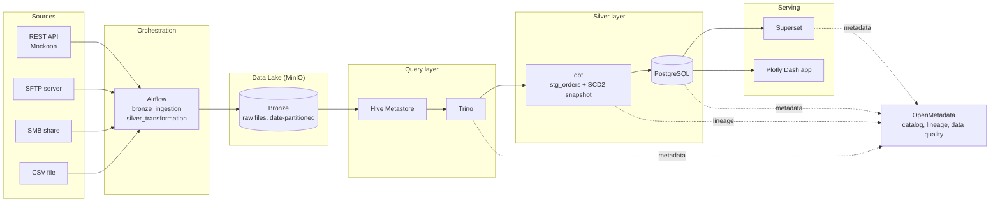

# Data as Code: End-to-End Data Platform

A fully containerized data platform, defined as code, that ingests multi-source e-commerce data into a data lake, transforms it with **dbt** and **Trino**, orchestrates everything with **Airflow**, catalogs it with **OpenMetadata**, and serves it through **Superset** and a custom **Plotly Dash** application. Pipelines are versioned in Git and deployed with **GitLab CI/CD**.

The platform uses the public [Olist Brazilian E-Commerce dataset](https://www.kaggle.com/datasets/olistbr/brazilian-ecommerce) as a realistic case study.


---

## Table of Contents

- [Architecture](#architecture)
- [Features](#features)
- [Tech Stack](#tech-stack)
- [Project Structure](#project-structure)
- [Pipelines](#pipelines)
- [Getting Started](#getting-started)
- [Services and Ports](#services-and-ports)
- [CI/CD](#cicd)
- [Data Governance and Quality](#data-governance-and-quality)
- [Known Limitations and Roadmap](#known-limitations-and-roadmap)

---

## Architecture



## Features

- **Multi-source ingestion**: REST API, SFTP, SMB file share and flat CSV, all landing in MinIO (S3-compatible) partitioned by `yyyy/mm/dd` with an `_ingestion_date` column.
- **Data-aware orchestration**: the silver pipeline is triggered automatically by an Airflow `Asset` when new bronze data lands.
- **SQL on the lake**: Trino and a Hive Metastore expose raw files as external tables.
- **Cleaning and modeling with dbt**: deduplication, typing, standardization and imputation across 8 source tables.
- **History tracking**: incremental dbt snapshot implementing SCD Type 2.
- **Data catalog and lineage**: OpenMetadata ingests Trino, PostgreSQL, dbt and Superset metadata, with profiling and data quality tests.
- **BI and analytics**: Superset dashboard created as code, plus a custom Dash app (revenue, delivery, satisfaction, products).
- **Automated deployment**: GitLab CI/CD with a self-hosted runner deploys DAGs to a production VM on every push to `main`.

## Tech Stack

| Layer | Technologies |
|-------|--------------|
| Orchestration | Apache Airflow |
| Storage | MinIO (data lake), PostgreSQL (silver layer) |
| Query engine | Trino, Hive Metastore |
| Transformation | dbt (dbt-trino), SQL |
| Governance | OpenMetadata (OpenSearch, MySQL backend) |
| BI | Apache Superset, Plotly Dash |
| Simulated sources | Mockoon (REST), SFTP, SMB (Samba), CSV |
| Infrastructure | Docker, Docker Compose |
| CI/CD | GitLab CI/CD, GitLab Runner |
| Languages | Python, SQL, Jinja, YAML |

## Project Structure

```
data-platform/
├── airflow/
│   └── dags/
│       ├── ingestion_bronze.py        # Sources -> MinIO (bronze)
│       └── silver_transformation.py   # Trino tables -> dbt -> OpenMetadata
├── dbt/
│   ├── models/
│   │   ├── staging/                   # stg_orders (cleaning, joins, imputation)
│   │   └── snapshots/                 # snap_stg_orders (SCD2)
│   └── profiles/                      # dbt profile (Trino connection)
├── trino/catalog/                     # hive and postgres catalogs
├── openmetadata/ingestion/            # ingestion workflows, profilers, dq tests
├── superset/                          # Dockerfile, config, dashboard-as-code
├── dashboard/                         # Plotly Dash application
├── fastapi/                           # API service (placeholder)
├── sources/                           # Simulated source systems (mockoon, sftp, smb, csv)
├── gitlab-runner/                     # Runner configuration
├── docker-compose.yml                 # Full stack (20 services)
├── Dockerfile.airflow                 # Airflow image with extra providers
└── .gitlab-ci.yml                     # CI/CD pipeline
```

## Pipelines

### 1. `bronze_ingestion` (daily, Africa/Tunis timezone)

| Task | Source | Destination |
|------|--------|-------------|
| `ingest_mockoon` | REST API: orders, order_items, customers | `bronze/mockoon/<table>/yyyy/mm/dd/` (NDJSON) |
| `ingest_sftp` | SFTP: products, sellers | `bronze/sftp/<table>/yyyy/mm/dd/` (CSV) |
| `ingest_smb` | SMB share: order_payments, order_reviews | `bronze/smb/<table>/yyyy/mm/dd/` (CSV) |
| `ingest_csv` | CSV file: geolocation | `bronze/csv/yyyy/mm/dd/` (CSV) |

### 2. `silver_transformation` (triggered by the bronze `Asset`)

```
create_hive_schema -> create_external_tables -> clean_before_run
   -> run_dbt_stg_orders -> create_snapshots_schema -> run_dbt_scd2
   -> om_ingest_trino -> om_ingest_postgres -> om_ingest_dbt
```

`stg_orders` joins and cleans eight sources (orders, order items, customers, sellers, products, payments, reviews, geolocation): deduplication, type casting, text standardization, category-based median imputation for product dimensions, and aggregation of payments and geolocation before joining.

## Getting Started

### 1. Clone the repository

```bash
git clone https://github.com/kallelsab/Data_As_Code.git
cd Data_As_Code
```

The Airflow services mount DAGs from `/opt/data-platform-prod/airflow/dags`. Either clone the repository to `/opt/data-platform-prod`, or edit the `volumes` entries of the Airflow services in `docker-compose.yml` to point to `./airflow/dags`.

### 2. Download the dataset

Download the **Brazilian E-Commerce Public Dataset by Olist** from Kaggle and place the CSV files as follows (these files are git-ignored):

| File | Destination |
|------|-------------|
| `olist_geolocation_dataset.csv` | `sources/csv/` |
| `olist_products_dataset.csv`, `olist_sellers_dataset.csv` | `sources/sftp/` |
| `olist_order_payments_dataset.csv`, `olist_order_reviews_dataset.csv` | `sources/smb/` |
| `olist_orders_dataset.csv`, `olist_order_items_dataset.csv`, `olist_customers_dataset.csv` | `sources/mockoon/` |

Then generate the JSON files served by the mock API:

```bash
cd sources/mockoon
python mock.py
cd ../..
```

### 3. Start the stack

Copy `.env.example` to `.env` and replace every `replace-with-...` value with a
unique local secret. The `.env` file is ignored by Git and must never be
committed.

```bash
docker compose up -d --build
```

### 4. Configure OpenMetadata

1. Open OpenMetadata (see ports below) and create a bot or personal access token.
2. Put the token in the `jwtToken` field of the YAML files in `openmetadata/ingestion/`.

### 5. Run the pipelines

1. Open the Airflow UI and trigger `bronze_ingestion` (it is also scheduled daily).
2. `silver_transformation` starts automatically once the bronze data is updated.

### 6. Create the Superset dashboard

The script `superset/assets/dashboards/superset_dashboard_as_code.py` creates the database connection, virtual datasets, charts and the dashboard through the Superset API. It targets `http://superset:8088`, so run it from a container on the same Docker network, or change `SUPERSET_URL`.

### 7. Open the dashboards

- Superset dashboard on port `8088`
- Dash analytics app on port `8050` (sign up, then log in)

## Services and Ports

| Service | Port | Purpose |
|---------|------|---------|
| Airflow API server / UI | 8080 | Orchestration |
| Trino | 8081 | SQL query engine |
| MinIO | 9000 (API), 9001 (console) | Data lake |
| PostgreSQL | 5432 | Silver layer and analytics |
| OpenMetadata | 8585 | Data catalog |
| OpenSearch | 9200 | OpenMetadata search backend |
| Superset | 8088 | BI dashboards |
| Dash app | 8050 | Custom analytics app |
| FastAPI | 8000 | API service (placeholder) |
| Mockoon | 3000 | Mock REST API source |
| SFTP | 2222 | Simulated SFTP source |
| SMB | 445 | Simulated file share source |
| Hive Metastore | 9083 | Table metadata for Trino |
| MySQL | 3306 | OpenMetadata database |

Default credentials are defined in `docker-compose.yml` for local use only. Change them before any shared or production deployment.

## CI/CD

`.gitlab-ci.yml` defines two stages:

- **test**: runner connectivity check.
- **deploy**: on every push to `main`, the `airflow/dags/` folder is synchronized to the production VM with `rsync` over SSH. The private key is provided through the `SSH_PRIVATE_KEY` CI/CD variable.

A self-hosted GitLab Runner runs as part of the Docker Compose stack.

## Data Governance and Quality

- **Catalog and lineage**: OpenMetadata ingests metadata from Trino, PostgreSQL, dbt artifacts and Superset after each silver run.
- **Profiling**: profiler workflows for Trino and PostgreSQL.
- **Data quality tests** on `silver.stg_orders` (defined in `openmetadata/ingestion/dq_tests.yaml`), including:
  - not-null checks on keys (`order_id`, `order_item_id`, `customer_id`)
  - accepted values for `order_status`
  - value ranges for `price`, `freight_value` and `review_score`


## Authors

**Saba Kallel & Oumayma Khlif**: Data Engineering students
